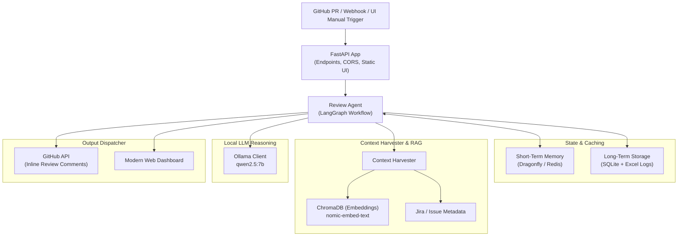

# CodeLens AI

## 1. What It Is
CodeLens AI is an automated, context-aware pull request code review agent built with FastAPI, LangGraph, and Ollama. It retrieves and scores relevant Jira tickets, architectural documentation, coding standards, and past reviews to assemble token-budget-optimized LLM prompts. Review results, including approval decisions and inline code comments, are posted back to GitHub, while metadata and execution history are logged to persistent SQLite and Excel stores.

## 2. Architecture Diagram




## 3. Prerequisites
- **Python**: `>=3.11`
- **Ollama**: Local LLM server running the specified models (`codellama`, `deepseek-coder`, `nomic-embed-text`)
- **DragonflyDB**: Redis-compatible high-performance in-memory cache
- **SQLite**: Local SQL database for review log persistence

## 4. Quick Start
1. **Start Services**: Start DragonflyDB and Ollama services (e.g., via docker-compose):
   ```bash
   docker compose up -d
   ```
2. **Ingest Documentation**: Add architectural guidelines, coding standards, or PR examples into ChromaDB (replace paths with your actual folders):
   ```bash
   python3 -m codelens.scripts.ingest --source data/arch_docs --type arch_doc
   python3 -m codelens.scripts.ingest --source data/standards --type standard
   ```
3. **Configure GitHub Webhook**: Deploy the FastAPI server and point a GitHub repository webhook (`/webhook/github`) with the `pull_request` event selected to your FastAPI server URL.

## 5. Configuration

| Variable Name | Description | Default Value |
| :--- | :--- | :--- |
| `GITHUB_TOKEN` | GitHub API personal access token. | `""` |
| `GITHUB_WEBHOOK_SECRET` | GitHub webhook secret for payload signature verification. | `""` |
| `OLLAMA_BASE_URL` | Base URL of the Ollama server. | `http://localhost:11434` |
| `OLLAMA_MODEL_CODE` | Model used for code generation and analysis. | `codellama` |
| `OLLAMA_MODEL_REASON` | Model used for reasoning/critique tasks. | `deepseek-coder` |
| `OLLAMA_EMBED_MODEL` | Model used for vector embeddings. | `nomic-embed-text` |
| `CHROMA_PATH` | Storage location for the Chroma vector DB. | `data/chroma` |
| `SQLITE_PATH` | Storage location for the SQLite database. | `data/sqlite/codelens.db` |
| `EXCEL_PATH` | Directory for Excel log spreadsheet storage. | `data/excel` |
| `DRAGONFLY_URL` | Redis-compatible Dragonfly database connection URL. | `redis://localhost:6379/0` |
| `MAX_CONTEXT_TOKENS` | Maximum tokens allowed for LLM prompt context. | `4096` |
| `LOG_LEVEL` | Application logging level (`DEBUG`, `INFO`, `WARNING`, `ERROR`). | `INFO` |

## 6. How Context Ranking Works
- **Hybrid Scoring**: Combines BM25 lexical search (40% weight) and semantic vector similarity (60% weight) to score retrieved architectural docs, standards, and past reviews against the PR diff and title.
- **Dynamic Compression**: LLM dynamically compresses low-scoring context chunks (relevance score < 0.3) that exceed 200 tokens into short summaries before assembly.
- **Priority-based Trimming**: Assembles context layers based on priority (System prompt=10, Jira ticket=9, Standards=8, Arch docs=7, Diffs=6, Past reviews=5), dropping lower priority layers greedily to fit the configured `MAX_CONTEXT_TOKENS` budget.

## 7. Excel Output Format
Column list from `PR Reviews` sheet:
- `date`: Timestamp of review completion (`%Y-%m-%d %H:%M:%S`)
- `pr_id`: ID of the Pull Request
- `repo`: Repository full name (`owner/repo`)
- `author`: GitHub handle of the PR author
- `jira_ticket`: Associated Jira ticket ID
- `approval`: Approval decision (`APPROVE`, `REQUEST_CHANGES`, `COMMENT`)
- `confidence`: Confidence score (0.0 to 1.0)
- `critical_issues`: Count of critical severity issues found
- `high_issues`: Count of high severity issues found
- `total_issues`: Total count of issues of all severities
- `summary`: High-level review summary comment
- `tokens_used`: Number of tokens consumed by the LLM
- `latency_ms`: Response latency of the review run in milliseconds
- `status`: Execution status (default: `"Reviewed"`)
