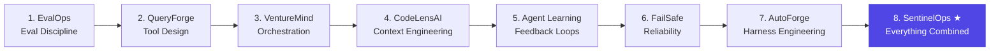

<div align="center">

# 🧠 Andrej Karpathy 2026 — AI Systems Engineering

**From flashy demos → production-grade autonomous systems**

[](https://python.org)
[](https://fastapi.tiangolo.com)
[](https://ollama.com)
[](https://google.github.io/adk-docs/)
[](LICENSE)

*8 production-grade projects • 33,600+ lines of Python • 437 source files • All local, all free*

</div>

---

## 🎯 What Is This?

A hands-on engineering curriculum inspired by [Andrej Karpathy's 2026 roadmap](https://x.com/karpathy) focused on the **boring things that actually compound** in modern AI systems:

| Skill | Where You Learn It | Codebase Link |
|---|---|---|
| **Context Engineering** | CodeLensAI — deciding *what* context matters for a PR review | [`./CodeLensAI`](./CodeLensAI) |
| **Tool Design** | QueryForge — building narrow, safe, composable tools | [`./queryforge`](./queryforge) |
| **Agent Orchestration** | VentureMind — coordinating 5 specialist agents | [`./VentureMind`](./VentureMind) |
| **Eval Discipline** | EvalOps — CI/CD for prompts with regression detection | [`./EvalOps`](./EvalOps) |
| **Agent Learning** | Agent Learning Pilot — measuring if agents improve with feedback | [`./agent-learning-pilot`](./agent-learning-pilot) |
| **Reliability Engineering** | FailSafe Agent — circuit breakers, fallback models, audit trails | [`./failsafe-agent`](./failsafe-agent) |
| **Harness Engineering** | AutoForge — sandboxed code execution with verification loops | [`./autoforge`](./autoforge) |
| **Full-Stack AI Ops** | SentinelOps — all of the above in one capstone system | [`./SentinelOps`](./SentinelOps) |

Every project runs **100% locally** using Ollama — zero paid API keys required.

---

## ⚡ Project Suite Matrix

| # | Project | Core Domain | Port | Dashboard URL | Direct Docs |
|---|---|---|---|---|---|
| 1 | [**EvalOps**](./EvalOps) | Prompt Regression & Evals | `8000` | [localhost:8000/dashboard](http://localhost:8000/dashboard) | [EvalOps/README.md](./EvalOps/README.md) |
| 2 | [**QueryForge**](./queryforge) | Multi-Tool Agent Routing | `8001` | [localhost:8001](http://localhost:8001) | [queryforge/README.md](./queryforge/README.md) |
| 3 | [**VentureMind**](./VentureMind) | Due Diligence Multi-Agent | `8002` | [localhost:8002](http://localhost:8002) | [VentureMind/README.md](./VentureMind/README.md) |
| 4 | [**CodeLensAI**](./CodeLensAI) | Context Packing PR Review | `8003` | [localhost:8003](http://localhost:8003) | [CodeLensAI/README.md](./CodeLensAI/README.md) |
| 5 | [**Agent Learning Pilot**](./agent-learning-pilot) | Feedback & Retention Science | `8004` | [localhost:8004](http://localhost:8004) | [agent-learning-pilot/README.md](./agent-learning-pilot/README.md) |
| 6 | [**FailSafe Agent**](./failsafe-agent) | Fault-Tolerant Support Agent | `8005` | [localhost:8005](http://localhost:8005) | [failsafe-agent/README.md](./failsafe-agent/README.md) |
| 7 | [**AutoForge**](./autoforge) | Autonomous Coding Sandbox | `8006` | [localhost:8006](http://localhost:8006) | [autoforge/README.md](./autoforge/README.md) |
| 8 | [**SentinelOps**](./SentinelOps) ★ | SRE DevOps Incident Response | `8007` | [localhost:8007](http://localhost:8007) | [SentinelOps/README.md](./SentinelOps/README.md) |

---

## 📐 Architecture Overview

```mermaid
graph TB
    subgraph "Project 1: EvalOps"
        E1["Golden Datasets"] --> E2["Eval Runner"]
        E2 --> E3["LLM-as-Judge + Scoring"]
        E3 --> E4["Regression Engine"]
        E4 --> E5["Dashboard :8000"]
    end

    subgraph "Project 2: QueryForge"
        Q1["Natural Language Query"] --> Q2["Tool Router"]
        Q2 --> Q3["SQL / Web / PDF / API"]
        Q3 --> Q4["Result Synthesis"]
        Q4 --> Q5["Dashboard :8001"]
    end

    subgraph "Project 3: VentureMind"
        V1["Startup Name"] --> V2["Orchestrator"]
        V2 --> V3["Market + Competitor + Finance + Legal + Summary Agents"]
        V3 --> V4["Due Diligence Report"]
        V4 --> V5["Dashboard :8002"]
    end

    subgraph "Project 4: CodeLensAI"
        C1["PR / Code Diff"] --> C2["Context Packer"]
        C2 --> C3["Review Agent"]
        C3 --> C4["Feedback + Scores"]
        C4 --> C5["Dashboard :8003"]
    end

    subgraph "Project 5: Agent Learning Pilot"
        A1["Benchmark Tasks"] --> A2["Agent + Feedback Loop"]
        A2 --> A3["Retention + Transfer Analysis"]
        A3 --> A4["Dashboard :8004"]
    end

    subgraph "Project 6: FailSafe Agent"
        F1["Support Request"] --> F2["Circuit Breaker"]
        F2 --> F3["Primary / Fallback LLM"]
        F3 --> F4["SHA-256 Audit Ledger"]
        F4 --> F5["Dashboard :8005"]
    end

    subgraph "Project 7: AutoForge"
        AF1["GitHub Issue"] --> AF2["Code Agent"]
        AF2 --> AF3["Sandbox Execution"]
        AF3 --> AF4["Test + Verify"]
        AF4 --> AF5["Dashboard :8006"]
    end

    subgraph "Project 8: SentinelOps ★"
        S1["Incident Alert"] --> S2["Multi-Agent Orchestrator"]
        S2 --> S3["Log + Metrics + Runbook Tools"]
        S3 --> S4["Resolution + Escalation"]
        S4 --> S5["Dashboard :8007"]
    end
```



---

## 🗂️ Project Catalog

### 1️⃣ [EvalOps](./EvalOps) — LLM Regression Testing Platform

> **CI/CD for your prompts and AI agents.**

| Attribute | Specification |
|---|---|
| **Directory** | [`./EvalOps`](./EvalOps) |
| **Port** | `8000` |
| **Core Skill** | Eval Discipline |
| **Key Features** | Golden datasets, LLM-as-judge, pairwise comparison, regression detection, human feedback loop |
| **Tech** | FastAPI, Ollama, SQLite, Chart.js, Watchdog |
| **Code Volume** | 3,301 lines across 25 files |

**What it does:** Run benchmark evaluations against any local LLM model. Score outputs with deterministic scoring (Jaccard, exact match) and LLM-as-judge. Detect regressions automatically when prompt changes degrade quality. Review everything in a live dashboard.

```bash
cd EvalOps
python -m venv .venv && source .venv/bin/activate
pip install -r requirements.txt
make seed && make run    # → http://localhost:8000/dashboard
```

---

### 2️⃣ [QueryForge](./queryforge) — Multi-Tool Research Agent

> **Ask a question, the agent picks the tools.**

| Attribute | Specification |
|---|---|
| **Directory** | [`./queryforge`](./queryforge) |
| **Port** | `8001` |
| **Core Skill** | Tool Design |
| **Key Features** | SQL query generation, web search, PDF summarization, chart rendering, tool selection reasoning |
| **Tech** | Google ADK, FastAPI, Ollama, aiosqlite, matplotlib |
| **Code Volume** | 3,821 lines across 34 files |

**What it does:** Type a natural language question like *"Find our highest churn customer segment and compare it with industry trends."* The agent decides which tools to call (SQL, web search, PDF reader, API), executes them in the right order, and synthesizes a coherent answer.

```bash
cd queryforge
python -m venv .venv && source .venv/bin/activate
pip install -e ".[dev]"
uvicorn src.api.main:app --port 8001 --reload  # → http://localhost:8001
```

---

### 3️⃣ [VentureMind](./VentureMind) — Startup Due Diligence Multi-Agent System

> **5 specialist agents analyze a startup before investment.**

| Attribute | Specification |
|---|---|
| **Directory** | [`./VentureMind`](./VentureMind) |
| **Port** | `8002` |
| **Core Skill** | Agent Orchestration |
| **Key Features** | Parallel agent execution, market research, competitor analysis, financial modeling, legal review, report synthesis |
| **Tech** | Google ADK, FastAPI, Ollama, aiosqlite |
| **Code Volume** | 6,605 lines across 51 files |

**What it does:** Provide a startup name and description. Five specialized agents (Market Research, Competitor Analysis, Financial Analysis, Legal Review, Summarization) run in parallel, share findings, and produce a comprehensive due diligence report.

```bash
cd VentureMind
python -m venv .venv && source .venv/bin/activate
pip install -e ".[dev]"
python scripts/seed_demo_samples.py
uvicorn src.api.app:app --port 8002 --reload  # → http://localhost:8002
```

---

### 4️⃣ [CodeLensAI](./CodeLensAI) — Autonomous PR Review Agent

> **AI reviewer that knows what context matters.**

| Attribute | Specification |
|---|---|
| **Directory** | [`./CodeLensAI`](./CodeLensAI) |
| **Port** | `8003` |
| **Core Skill** | Context Engineering |
| **Key Features** | Code diff analysis, context compression, review scoring, security/performance flags, review history |
| **Tech** | FastAPI, Ollama, SQLite |
| **Code Volume** | 4,238 lines across 34 files |

**What it does:** Paste a code diff or connect a repo. The agent analyzes changed files, retrieves relevant architecture docs and coding standards, compresses context to fit the model window, and produces a detailed code review with scores for correctness, security, and maintainability.

```bash
cd CodeLensAI
python -m venv .venv && source .venv/bin/activate
pip install -e ".[dev]"
python codelens/scripts/seed_demo_reviews.py
uvicorn codelens.src.api.main:app --port 8003 --reload  # → http://localhost:8003
```

---

### 5️⃣ [Agent Learning Pilot](./agent-learning-pilot) — Can Agents Learn From Feedback?

> **A controlled experiment measuring agent improvement over time.**

| Attribute | Specification |
|---|---|
| **Directory** | [`./agent-learning-pilot`](./agent-learning-pilot) |
| **Port** | `8004` |
| **Core Skill** | Agent Learning & Evaluation |
| **Key Features** | Controlled A/B experiments, retention curves, transfer learning analysis, cost-vs-capability tracking |
| **Tech** | FastAPI, Ollama, pandas, matplotlib |
| **Code Volume** | 4,759 lines across 189 files |

**What it does:** Runs controlled experiments to measure whether coding agents genuinely improve when given structured feedback. Tracks retention (do improvements stick?), transfer (do improvements generalize?), and cost-effectiveness across experiment conditions.

```bash
cd agent-learning-pilot
python -m venv .venv && source .venv/bin/activate
pip install -e ".[dev]"
python scripts/serve_results.py 8004  # → http://localhost:8004
```

---

### 6️⃣ [FailSafe Agent](./failsafe-agent) — Resilient AI Support Agent

> **When the model fails, the system doesn't.**

| Attribute | Specification |
|---|---|
| **Directory** | [`./failsafe-agent`](./failsafe-agent) |
| **Port** | `8005` |
| **Core Skill** | Reliability Engineering |
| **Key Features** | Circuit breakers, fallback LLM chains, retry with exponential backoff, SHA-256 audit ledger, human escalation |
| **Tech** | FastAPI, Ollama, SQLite, hashlib |
| **Code Volume** | 5,317 lines across 54 files |

**What it does:** A customer support agent that handles refund requests, policy lookups, and payment actions — with production-grade resilience. If the primary LLM times out, a circuit breaker trips and falls back to a deterministic engine. Every action is recorded in a cryptographic SHA-256 audit ledger.

```bash
cd failsafe-agent
python -m venv .venv && source .venv/bin/activate
pip install -e ".[dev]"
uvicorn src.main:app --port 8005 --reload  # → http://localhost:8005
```

---

### 7️⃣ [AutoForge](./autoforge) — Autonomous Software Engineering Sandbox

> **Agent writes code, sandbox runs it, tests verify it.**

| Attribute | Specification |
|---|---|
| **Directory** | [`./autoforge`](./autoforge) |
| **Port** | `8006` |
| **Core Skill** | Harness Engineering |
| **Key Features** | Issue-to-PR pipeline, sandboxed code execution, test verification loops, artifact logging, rollback |
| **Tech** | FastAPI, Ollama, SQLite, subprocess isolation |
| **Code Volume** | 4,747 lines across 41 files |

**What it does:** Feed it an issue description. The agent generates code, executes it in an isolated sandbox, validates outputs against unit tests, and produces a verified artifact. If tests fail, it iterates autonomously.

```bash
cd autoforge
python -m venv .venv && source .venv/bin/activate
pip install -e ".[dev]"
python scripts/seed_demo_tasks.py
uvicorn src.main:app --port 8006 --reload  # → http://localhost:8006
```

---

### 8️⃣ [SentinelOps](./SentinelOps) — AI DevOps Incident Response ★ Capstone

> **Everything from projects 1–7, combined into one production system.**

| Attribute | Specification |
|---|---|
| **Directory** | [`./SentinelOps`](./SentinelOps) |
| **Port** | `8007` |
| **Core Skill** | Full-Stack AI Systems Engineering |
| **Key Features** | Multi-agent investigation, log analysis, metrics querying, runbook search, escalation logic, cryptographic audit ledger |
| **Tech** | FastAPI, Ollama, SQLite, SHA-256 hash chaining |
| **Code Volume** | 847 lines across 9 files |

**What it does:** Detects infrastructure incidents, then orchestrates a multi-agent investigation: one agent triages severity, another pulls logs, another queries metrics, another searches runbooks. The orchestrator synthesizes findings into a remediation plan or escalates to a human SRE. Every event is saved in a tamper-evident audit ledger.

```bash
cd SentinelOps
python -m venv .venv && source .venv/bin/activate
pip install -e ".[dev]"
python scripts/seed_incidents.py
uvicorn src.main:app --port 8007 --reload  # → http://localhost:8007
```

---

## 🚀 Quick Start (All Projects)

### Prerequisites

| Requirement | Recommended Version | Purpose |
|---|---|---|
| **Python** | `3.11+` | Core execution environment |
| **Ollama** | Latest | Local LLM inference server |
| **Model** | `qwen2.5:7b` | Primary inference model |

```bash
# 1. Install & start Ollama (macOS / Linux)
brew install ollama  # or curl -fsSL https://ollama.com/install.sh | sh
ollama serve

# 2. Pull the default reasoning model
ollama pull qwen2.5:7b
```

### Clone and Run

```bash
git clone https://github.com/simranjeet97/AndrejKarpathy_2026_FocusProjects.git
cd AndrejKarpathy_2026_FocusProjects
```

Choose any project folder from above, activate its virtual environment, seed its demo data, and start its Uvicorn dev server.

---

## 🎨 UI Design System

All 8 web applications share a standardized, accessible **high-density ops design system**:
* **Canvas Background**: High-contrast, clean light theme (`#f8fafc`).
* **Container Width**: Optimized 1560px grid layouts with responsive micro-cards.
* **Component Palette**: Neutral slate (`#0f172a` text, `#e2e8f0` borders) paired with indigo accents (`#4f46e5`).
* **Zero Ambiguity**: Instant status badges (`RESOLVED`, `ESCALATED`, `HEALTHY`), raw payload inspect modals, and one-click JSON exports.

---

## 📁 Repository Structure

```
AndrejKarpathy_2026_FocusProjects/
├── EvalOps/                    # Project 1: LLM Regression Testing
│   ├── evalops/                #   Core library (runner, scorer, judge, etc.)
│   ├── golden_datasets/        #   Benchmark task definitions
│   ├── templates/              #   Dashboard HTML
│   └── tests/                  #   26 pytest tests
│
├── queryforge/                 # Project 2: Multi-Tool Research Agent
│   └── src/
│       ├── agent/              #   Agent logic & tool router
│       ├── tools/              #   SQL, web, PDF, chart tools
│       └── api/                #   FastAPI endpoints + dashboard
│
├── VentureMind/                # Project 3: Multi-Agent Due Diligence
│   └── src/
│       ├── agents/             #   5 specialist agents
│       ├── orchestrator/       #   Parallel coordination
│       └── report/             #   Report generation
│
├── CodeLensAI/                 # Project 4: PR Review Agent
│   └── codelens/
│       └── src/
│           ├── api/            #   Endpoints + dashboard
│           └── agents/         #   Review agent + context packer
│
├── agent-learning-pilot/       # Project 5: Agent Learning Experiments
│   └── src/
│       └── agent_learning/     #   Experiment runner + analysis
│
├── failsafe-agent/             # Project 6: Resilient Support Agent
│   └── src/
│       ├── resilience/         #   Circuit breaker, fallback LLM
│       ├── policy/             #   Support policies
│       └── observability/      #   Logging + metrics
│
├── autoforge/                  # Project 7: Autonomous SWE Sandbox
│   └── src/
│       ├── harness/            #   Sandbox execution engine
│       ├── guardrails/         #   Safety checks
│       └── agent/              #   Code generation agent
│
├── SentinelOps/                # Project 8: DevOps Incident Response ★
│   └── src/
│       ├── agents/             #   Multi-agent orchestrator
│       ├── tools/              #   Log, metrics, runbook tools
│       └── database.py         #   Audit ledger with hash chaining
│
├── .gitignore                  # Comprehensive gitignore (venv, caches, dbs)
└── README.md                   # ← Comprehensive Project Suite Documentation
```

---

## 🧭 Recommended Learning Path



Each project builds on skills from the previous ones. By the time you reach SentinelOps, you've practiced every production AI engineering pattern.

---

## 🤝 Contributing

1. Fork the repository
2. Create a feature branch (`git checkout -b feature/amazing-feature`)
3. Commit your changes (`git commit -m 'feat: add amazing feature'`)
4. Push to the branch (`git push origin feature/amazing-feature`)
5. Open a Pull Request

---

## 📄 License

This project is licensed under the MIT License — see the [LICENSE](LICENSE) file for details.

---

<div align="center">

**Built with 🧠 by [Simranjeet Singh](https://github.com/simranjeet97)**

*"These projects move you from building flashy demos to building production-grade AI systems that companies actually need."*
— Andrej Karpathy

</div>
