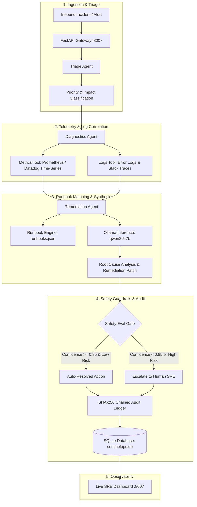

<div align="center">

# 🛡️ SentinelOps — Autonomous AI DevOps Incident Response Agent

**Production-Grade Site Reliability Engineering • Multi-Agent Root Cause Analysis • Cryptographic Audit Ledger**

[](https://python.org)
[](https://fastapi.tiangolo.com)
[](https://ollama.com)
[](https://sqlite.org)
[](../LICENSE)

*The Capstone Project of the Andrej Karpathy 2026 AI Systems Engineering Focus Series*

</div>

---

## 📌 Executive Summary

**SentinelOps** is an autonomous Site Reliability Engineering (SRE) incident response agent that detects outages, correlates metric anomalies, extracts log traces, queries runbooks, coordinates multi-agent investigations, synthesizes remediation patches, verifies safety guardrails, and maintains an immutable cryptographic audit ledger.

This capstone project synthesizes all core disciplines across the **Andrej Karpathy 2026 AI Systems Roadmap**:
* **Context Engineering**: Selective log/metric windowing without prompt bloat.
* **Tool Design**: Strongly scoped telemetry query tools, log scrapers, and runbook matchers.
* **Agent Orchestration**: Collaborative multi-agent workflow (Triage → Diagnostics → Remediation).
* **Evaluation Discipline**: Safety evaluation gate evaluating patch confidence, risk levels, and blast radius.
* **Reliability Engineering**: Resilient local-fallback diagnostics if external or local LLM instances fail.
* **Audit & Harness Engineering**: Cryptographic SHA-256 hash-chained audit ledger ensuring tamper-evident action provenance.

---

## 🏛️ System Architecture



---

## ⚡ Key Features

1. **Autonomous Incident Processing**:
   Ingests raw incident reports or webhook alerts, extracting target microservices, severity levels (`P1`/`P2`), and alert descriptions.
2. **Deterministic Metric & Log Diagnostics**:
   Correlates real-time telemetry (CPU/Memory saturation, P99 latency spikes, HTTP 5xx error rates, worker connection pools, conntrack limits) with diagnostic stack traces.
3. **Runbook Matching Engine**:
   Evaluates symptom signatures against organizational runbooks (`runbooks.json`), scoring matches by service taxonomy and diagnostic keywords.
4. **Local LLM-Driven Root Cause Reasoning**:
   Uses local Ollama (`qwen2.5:7b`) to synthesize concise, actionable incident assessments and exact infrastructure patches (`kubectl`, `pgbouncer-cli`, `redis-cli`, `sysctl`).
5. **Safety Evaluation Gate**:
   Verifies generated remediation actions against risk thresholds (`confidence >= 0.85`, blast radius assessment) to either execute or escalate to an on-call engineer.
6. **SHA-256 Cryptographic Hash Chaining**:
   Every diagnostic finding, triage decision, and remediation patch is logged into a tamper-evident audit ledger with cryptographically chained hashes anchored to `GENESIS_ROOT`.
7. **Clean High-Density SRE Dashboard**:
   Light-themed (`#f8fafc`), 1560px grid dashboard providing single-click incident simulation, live telemetry drilldowns, remediation patch inspect/copy, and immutable audit trails.

---

## 🗂️ Project Structure

```
SentinelOps/
├── pyproject.toml              # Dependencies & project metadata
├── sentinelops.db              # SQLite runtime database & audit ledger
├── scripts/
│   └── seed_incidents.py       # High-fidelity realistic SRE demo dataset
└── src/
    ├── __init__.py
    ├── config.py               # Pydantic environment configuration
    ├── database.py             # SQLite pool, async schema, and SHA-256 audit ledger
    ├── main.py                 # FastAPI application, REST endpoints, static mount
    ├── agents/
    │   ├── __init__.py
    │   └── orchestrator.py     # Multi-agent investigation & triage loop
    ├── static/
    │   └── index.html          # Clean 1560px light-themed SRE dashboard
    └── tools/
        ├── __init__.py
        ├── logs_tool.py        # Diagnostic log and stack trace extractor
        ├── metrics_tool.py     # Time-series telemetry query simulator
        ├── runbook_tool.py     # Fuzzy runbook search & scoring
        └── runbooks.json       # Production runbook repository
```

---

## 🚀 Quick Start Guide

### Prerequisites
* **Python**: 3.11+
* **Ollama**: Running locally with `qwen2.5:7b` (fallback heuristic engine activates automatically if Ollama is offline)

```bash
# Verify Ollama is running and has the model
ollama pull qwen2.5:7b
```

### 1. Installation

From the `SentinelOps` directory:

```bash
# Create and activate virtual environment
python3 -m venv .venv
source .venv/bin/activate

# Install dependencies
pip install -e .
```

### 2. Seed Realistic Benchmark Incidents

Populate the local SQLite database with real-world infrastructure incidents (OOMKilled pods, PgBouncer pool starvation, 502 Bad Gateway spikes, Redis memory pressure, CoreDNS SERVFAIL):

```bash
python scripts/seed_incidents.py
```

### 3. Start the Server

```bash
uvicorn src.main:app --host 0.0.0.0 --port 8007 --reload
```

Open your browser to **[http://localhost:8007](http://localhost:8007)** to access the live dashboard.

---

## 📡 API Reference

| Method | Endpoint | Description |
|---|---|---|
| `GET` | `/health` | Health check verifying SQLite connection, Ollama availability, and loaded runbooks |
| `GET` | `/api/incidents` | Retrieves the latest 50 investigated incidents and remediation statuses |
| `POST` | `/api/incidents` | Triggers the autonomous multi-agent incident response investigation |
| `GET` | `/api/runbooks` | Returns all pre-configured SRE runbooks in `runbooks.json` |
| `GET` | `/api/audit-trail` | Returns the cryptographic SHA-256 audit ledger with hash links |

### Sample Incident Ingestion (`POST /api/incidents`)

```bash
curl -X POST http://localhost:8007/api/incidents \
  -H "Content-Type: application/json" \
  -d '{
    "service": "payment-service-v2",
    "title": "Pod CrashLoopBackOff & Exit Code 137",
    "description": "Container continuously crashing during traffic spikes. Memory limit set to 4Gi.",
    "severity": "P1"
  }'
```

#### Sample Response:
```json
{
  "incident_id": "inc_9f3a12b4",
  "incident_number": 106,
  "service": "payment-service-v2",
  "severity": "P1",
  "title": "Pod CrashLoopBackOff & Exit Code 137",
  "status": "RESOLVED",
  "root_cause": "JVM Old Generation heap allocation peaked at 4.28Gi triggering Linux cgroup OOM killer (exitCode 137).",
  "remediation_patch": "kubectl patch deployment payment-service-v2 -n production --patch '{\"spec\":{\"template\":{\"spec\":{\"containers\":[{\"name\":\"app\",\"resources\":{\"limits\":{\"memory\":\"6Gi\"},\"requests\":{\"memory\":\"4Gi\"}}}]}}}}'",
  "confidence_score": 0.96,
  "risk_level": "LOW",
  "eval_passed": true,
  "audit_hash": "a1f8c9e2b4d70154823901452938472910492837461928374659283746192837",
  "metrics": {
    "memory_saturation_pct": 107.0,
    "exit_code": 137,
    "status": "CRITICAL"
  }
}
```

---

## 🔬 Benchmark Scenarios Included

The seeded environment models 5 production failure modes:

1. **Kubernetes OOMKilled (`payment-service-v2`)**:
   * *Symptom*: ExitCode 137, 14 pod restarts/hr, memory saturation at 107%.
   * *Remediation*: Dynamic patch increasing memory limit from 4Gi to 6Gi.
2. **PostgreSQL Connection Pool Starvation (`rds-core-db`)**:
   * *Symptom*: PgBouncer connections hit 500/500 ceiling, 182 queued client threads, P99 latency 4,820ms.
   * *Remediation*: Termination of idle-in-transaction sessions and dynamic pool expansion to 750.
3. **Ingress 502 Bad Gateway Spike (`api-gateway-proxy`)**:
   * *Symptom*: 18.4% HTTP 5xx error rate, upstream billing pods dropping to 3/8 healthy.
   * *Remediation*: Horizontal scaling of billing upstream deployment to 12 replicas.
4. **Redis Cache Saturation & Eviction Storm (`cache-cluster-01`)**:
   * *Symptom*: Memory hit 15.8GB / 16GB (98.7%), 4,210 key evictions/sec, hit ratio collapsed to 41.2%.
   * *Remediation*: Switch eviction policy to `volatile-lru` and purge stale memory segments.
5. **CoreDNS SERVFAIL Resolution Degradation (`auth-dns-resolver`)**:
   * *Symptom*: UDP packet drops, Linux worker node conntrack table saturation at 94.6%.
   * *Remediation*: Horizontal scaling of CoreDNS to 6 replicas and dynamic increase of `net.netfilter.nf_conntrack_max`.

---

## 🔒 Cryptographic Audit Integrity

Every event written to `audit_ledger` is computed deterministically:

$$\text{hash}_n = \text{SHA256}(\text{hash}_{n-1} \parallel \text{incident\_id} \parallel \text{event\_type} \parallel \text{payload\_json} \parallel \text{timestamp})$$

The genesis entry for an incident links to `GENESIS_ROOT`. Any manual tampering with historical rows in SQLite breaks the hash verification chain, giving DevOps and security teams verifiable compliance.

---

## 📄 License

This project is open-source under the [MIT License](../LICENSE).
