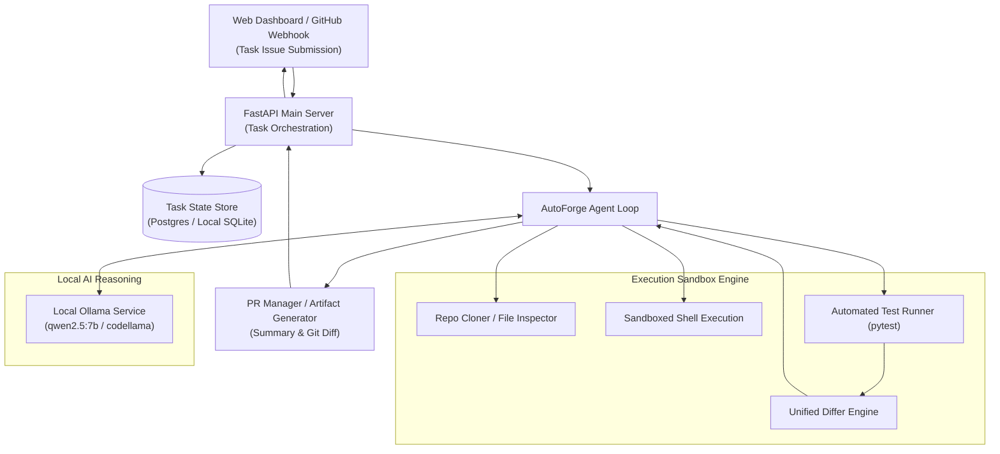

# AutoForge 🛠️⚡

**Autonomous Software Engineering (SWE) Agent & Sandbox Execution Engine.**

AutoForge is a local-first autonomous software engineering agent that accepts bug reports and feature requests, explores the repository codebase, isolates execution inside sandboxes, generates unified git diff patches using local LLMs (Ollama `qwen2.5:7b`), and verifies changes with automated test suites before creating pull requests.

---

## 🏗️ Architecture



---

## 🌟 Key Features

1. **Local-First & Offline**: Powered entirely by local Ollama models (`qwen2.5:7b`) with zero required external paid APIs.
2. **Deterministic Sandboxing**: Executes file modifications and test runners in isolated workspaces to prevent unwanted host system mutations.
3. **Automated Verification Loop**: Runs repository test suites before and after patches to ensure zero test regressions.
4. **Modern Minimalist UI**: Clean, glassmorphic dashboard to submit tasks, monitor agent steps, inspect generated git diffs, and review task execution history.

---

## 🚀 Quick Start

### 1. Prerequisites
- Python 3.9+ or 3.11+
- [Ollama](https://ollama.ai) running locally with `qwen2.5:7b`:
  ```bash
  ollama run qwen2.5:7b
  ```

### 2. Installation
```bash
cd autoforge
python3 -m venv .venv
source .venv/bin/activate
pip install -r requirements.txt
```

### 3. Launch Server & UI
```bash
python3 -m uvicorn src.main:app --host 0.0.0.0 --port 8000 --reload
```
Open your browser at:
👉 **`http://localhost:8000`**

---

## 🧪 Testing AutoForge

### Run Automated Unit Tests
```bash
pytest
```

### Test Via Web UI
1. Navigate to `http://localhost:8000`.
2. Fill in the **Submit SWE Task** form:
   - **Repository**: `fastapi/fastapi`
   - **Issue Title**: `Fix JWT token expiration handling`
   - **Issue Details**: `JWT verification should catch ExpiredSignatureError and return HTTP 401 instead of unhandled 500.`
3. Click **Dispatch AutoForge Agent**.
4. The dashboard will trigger the agent loop, synthesize the patch using local Ollama, and display the resulting unified git diff.

### Test Via CLI / cURL
```bash
curl -X POST http://localhost:8000/api/tasks \
  -H "Content-Type: application/json" \
  -d '{
    "repo_full_name": "owner/sample-repo",
    "title": "Fix off-by-one error in pagination calculation",
    "body": "When total items equals limit, an extra empty page is generated."
  }'
```
